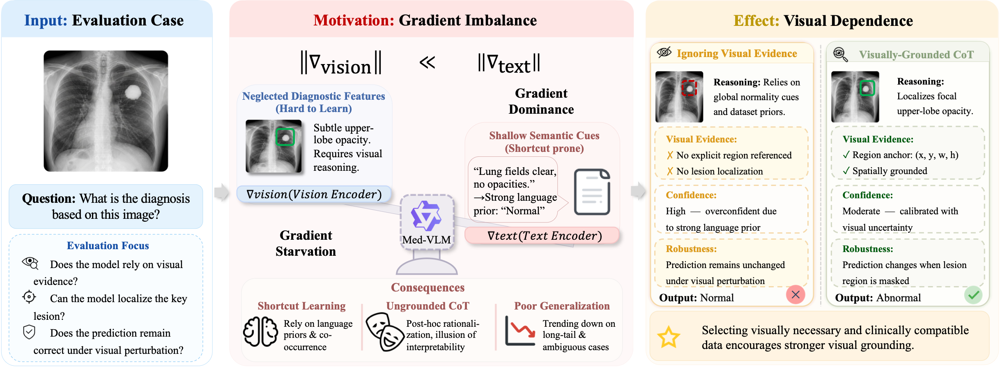

# Estimating Visual Necessity via Counterfactual Residuals for Multimodal Medical Data Selection 

## NeurIPS 2026 [Arxiv](https://arxiv.org/abs/2610.25202)

*Haotian Gan, Yudong Li, Xintian Li, Jiarui Han, Weidong Tang*



## Abstract

Medical vision-language models often exhibit hidden stratification, where high overall performance masks failures on subtle visual findings and overlapping clinical conditions. We trace this failure mode to modality imbalance during fine-tuning, where strong linguistic priors can suppress visually grounded learning and induce plausible but weakly grounded rationales. Existing data selection methods usually score image-text pairs as holistic units, without separating visually necessary samples from shortcut-solvable ones. To address this problem, we propose **ViCoR**, a counterfactual-residual-based data selection method for Med-VLM fine-tuning. ViCoR estimates visual necessity through image-dependent optimization residuals, calibrates the resulting scores with medical supervision compatibility, and constructs a diversity-aware fine-tuning subset. Across two backbones, four external generalization benchmarks, and one multi-disease robustness benchmark, ViCoR-selected 20% subsets achieve the strongest average performance compared with full-data fine-tuning and selection baselines. Gradient-level analysis and perturbation audits further show that ViCoR enriches image-dependent training signals and strengthens image-level and evidence-region dependence.

This repository contains the Qwen3-VL implementation: the ViCoR scorer, subset selection, LoRA fine-tuning, and the evaluation chain. Datasets, images, and checkpoints are obtained from their original providers.

## Repository Structure

```text
vicor/              library: configuration, data collators and label masks, Qwen3-VL LoRA wrapper, scoring
  scoring/          ViCoR score (counterfactual residual, Eqs. 3-8)
  data/             collators, mean-image shortcut control, final-answer label masks
scripts/            data preparation, scoring, shard merging, subset selection, export, ablations
configs/            experiment configurations: GEMeX, S-Chain, CXR single-/multi-disease
training/           direct LoRA trainer and the optional LLaMA-Factory wrapper
evaluation/         benchmark evaluators (DrVD, CheXbench, OmniMedVQA, ...) and aggregation
examples/           end-to-end shell workflows
requirements.txt
```

## 🚀 Quick Start

### Prerequisites

```bash
pip install -r requirements.txt
export PYTHONPATH="$PWD"

export BASE_MODEL_PATH=/path/to/qwen3-vl-checkpoint
export DATA_ROOT=/path/to/datasets
export OUTPUT_ROOT=outputs/gemex_vicor
export EVAL_ROOT=/path/to/benchmark_root
```

### Basic Usage

Score a training pool, select the ViCoR subset, and export it for fine-tuning:

```bash
bash examples/run_selection_workflow.sh
```

This workflow will:
1. Score every example with the counterfactual residual (`scripts/01_score_vicor.py`)
2. Calibrate the scores with supervision compatibility and run MMR selection (`scripts/02_select_subset.py`)
3. Export the selected subset in LLaMA-Factory format (`scripts/03_export_to_llama_factory_*.py`)

Fine-tune and evaluate:

```bash
export DATASET_DIR="$OUTPUT_ROOT/gemex_qwen3vl_vicor/llama_factory_data"   # written by the selection workflow
bash examples/run_qwen3vl_training.sh        # LoRA fine-tuning on the selected subset
bash examples/run_qwen3vl_three_seeds.sh     # seeds 17 / 42 / 73 with evaluation and aggregation
bash examples/run_qwen3vl_evaluation.sh      # full benchmark evaluation of a checkpoint
```

## Citation

```bibtex
@misc{gan2026vicorestimatingvisualnecessity,
      title={ViCoR: Estimating Visual Necessity via Counterfactual Residuals for Multimodal Medical Data Selection}, 
      author={Haotian Gan and Yudong Li and Xintian Li and Jiarui Han and Weidong Tang},
      year={2026},
      eprint={2610.25202},
      archivePrefix={arXiv},
      primaryClass={cs.LG},
      url={https://arxiv.org/abs/2610.25202}, 
}
```

